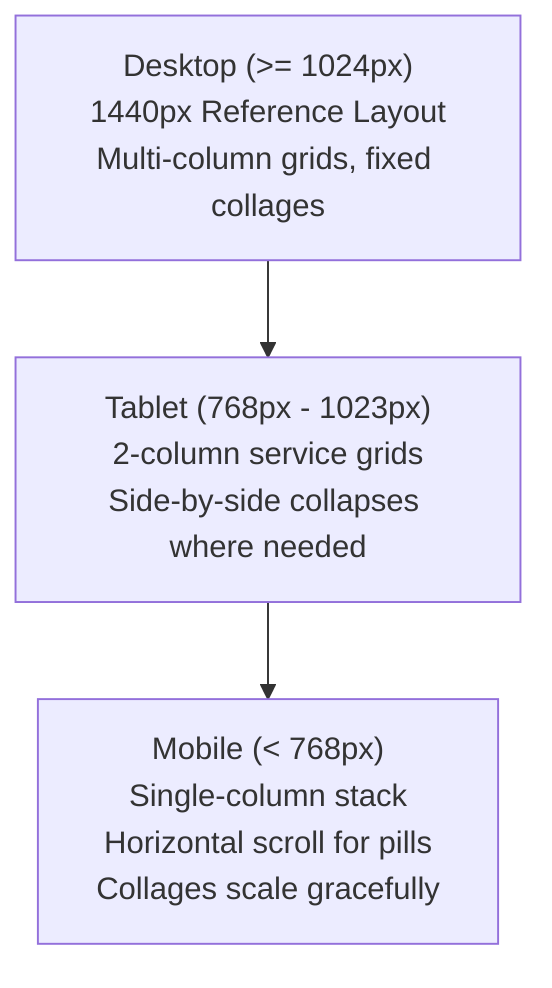

# Design Specification: Backspace Landing Page

## 1. Overview & Purpose

This document provides a comprehensive design specification for reconstructing the Backspace corporate landing page based on the visual design reference in [`docs/reference.png`](file:///home/tanvir/practice/backspace-next/docs/reference.png).

The reference image is a desktop export (1440 × 5859 px) from Figma. The design presents Backspace as a modern MediaTech ecosystem company blending media, technology, digital marketing, content creation, and software development.

---

## 2. Page Structure & Section Hierarchy

The landing page consists of **11 distinct visual blocks/sections** arranged in a deliberate alternating light/dark rhythm:

| Order | Section Name | Background | Visual Weight | Alignment / Layout |
| :--- | :--- | :--- | :--- | :--- |
| **01** | **Header / Navigation** | Transparent (Overlaid on Hero) | Minimal / Float | Edge-to-edge logo left, 9-dot menu right |
| **02** | **Hero Section** | Dark office photo + overlay | High / Impact | Centered punchy headline over full-width imagery |
| **03** | **Backspace at a Glance** | Black (`#000000`) | Compact / Statement | Centered cyan chevron badge + narrative paragraph |
| **04** | **Our Concerns** | White (`#ffffff`) | Medium / Cards | Centered heading, filter pills, 3 portfolio cards |
| **05** | **Industries & Capabilities** | Charcoal (`#121212`) | High / Grid | 2-column header + 2×3 service grid with cyan bottom lines |
| **06** | **Offices Across the Globe** | White (`#ffffff`) | High / Graphic | Centered heading, toggle pills, interactive vector world map |
| **07** | **Pushing Boundaries & Metrics**| Charcoal (`#121212`) | High / Metrics | 2×2 stat metrics grid (left) + narrative & CTA (right) |
| **08** | **Transforming the Industry** | White (`#ffffff`) | High / Asymmetric | 3-photo overlapping collage (left) + narrative, CTA, stat (right) |
| **09** | **Culture & Video Showcase** | Charcoal (`#121212`) | High / Visual | Stepped retreat collage with sparkle star (left) + video card (right) |
| **10** | **Brand Ecosystem Skyline** | White (`#ffffff`) | Medium / Illustrative| Vector city skyline with branded billboard signs |
| **11** | **Footer** | Dark Gray (`#353535`) | High / Functional | 5 columns (brand/contact, 3 link columns, FB widget) + copyright & back-to-top |

---

## 3. Layout, Container Widths, Grid Proportions & Alignment

### 3.1 Viewport & Containers
- **Reference Viewport Width**: 1440 px.
- **Outer Header / Skyline / Footer Bleed**: Full-width (`w-full`), edge-to-edge.
- **Primary Content Container**:
  - Maximum content width: **~980 px – 1000 px** (approximately Tailwind `max-w-5xl` / `max-w-[1000px]`).
  - Margins at 1440 px desktop: ~220 px horizontal gutters on each side (`mx-auto px-4 sm:px-6 lg:px-8`).
- **Secondary Tight Container** (Hero text, "At a Glance"):
  - Maximum width: **~680 px – 740 px** (`max-w-2xl` / `max-w-3xl`), centered horizontally.

### 3.2 Spacing & Section Heights (Desktop Baseline)
- **Header**: Height ~60 px, logo x=75 px, 9-dot grid x=1287 px.
- **Hero**: Height ~700 px (`min-h-[650px] lg:h-[700px]`), headline centered vertically and horizontally.
- **At a Glance**: Height ~280 px, compact vertical padding (`py-16 md:py-20`).
- **Our Concerns**: Height ~600 px (`py-20 md:py-24`).
- **Industries & Capabilities**: Height ~880 px (`py-24 md:py-28`).
- **Offices Across the Globe**: Height ~880 px (`py-20 md:py-24`).
- **Pushing Boundaries**: Height ~660 px (`py-20 md:py-24`).
- **Transforming MediaTech**: Height ~640 px (`py-20 md:py-24`).
- **Culture & Video**: Height ~520 px (`py-16 md:py-20`).
- **Skyline Illustration**: Height ~400 px, bottom-aligned flush to footer.
- **Footer**: Height ~320 px (`py-14 md:py-16`).

---

## 4. Typography Specifications

The design features a high-contrast typographic pairing: a bold condensed sans-serif for impact headlines paired with a clean, geometric/grotesque sans-serif for body copy and navigational controls.

### 4.1 Typeface Families
- **Headline Font (`font-heading`)**: Bold condensed uppercase sans-serif (e.g. *Barlow Condensed*, *Oswald*, *Saira Condensed*, or *Geist* with `font-black uppercase tracking-tight scale-y-105`).
- **Body Font (`font-sans`)**: Clean neo-grotesque / modern sans-serif (e.g. *Geist Sans*, *Inter*).

### 4.2 Scale, Weights & Hierarchy

| Element | Weight | Case / Transform | Approx Size (Desktop) | Line Height | Tracking |
| :--- | :--- | :--- | :--- | :--- | :--- |
| **Hero Headline** | 800 (ExtraBold) | UPPERCASE | 48 – 54 px (`text-4xl md:text-5xl lg:text-[54px]`) | 1.1 | Tight (`-0.02em`) |
| **Primary Section Headings** | 800 (ExtraBold) | UPPERCASE | 36 – 42 px (`text-3xl md:text-4xl lg:text-[40px]`) | 1.15 | Tight (`-0.02em`) |
| **Secondary Headings** | 700 (Bold) | UPPERCASE | 28 – 32 px (`text-2xl md:text-3xl`) | 1.2 | Tight (`-0.01em`) |
| **Card / Service Titles** | 600 (SemiBold) | Title Case | 18 – 20 px (`text-lg md:text-xl`) | 1.3 | Normal |
| **Large Metric Numbers** | 800 (ExtraBold) | Title Case | 44 – 52 px (`text-4xl md:text-5xl`) | 1.0 | Tight |
| **Metric Labels** | 700 (Bold) | UPPERCASE | 11 – 13 px (`text-xs md:text-sm`) | 1.2 | Wider (`0.05em`) |
| **Body Paragraphs** | 400 (Regular) | Sentence Case | 13 – 15 px (`text-sm md:text-base`) | 1.5 – 1.6 | Normal |
| **Buttons & Badges** | 600 (SemiBold) | UPPERCASE / Title | 12 – 14 px (`text-xs md:text-sm`) | 1.0 | Wide (`0.03em`) |
| **Footer Links / Body** | 400 / 500 | Sentence / Title | 12 – 13 px (`text-xs`) | 1.8 | Normal |

---

## 5. Color Palette, Visual Tokens & Effects

### 5.1 Color Tokens

```css
/* Color Palette Extracted from docs/reference.png */
:root {
  /* Brand Accents */
  --brand-cyan: #1ca6e1;        /* Primary bright accent, logo chevron, active pills, icons */
  --brand-cyan-hover: #1693c9;  /* Hover state */
  --brand-navy-dark: #03194e;   /* Headings on light backgrounds */
  --brand-navy-button: #0e2b5c; /* CTA button background, active dark pills */
  --brand-navy-card-border: #03194e;

  /* Backgrounds */
  --bg-dark-black: #000000;     /* Section 02 (At a Glance) */
  --bg-dark-charcoal: #121212;  /* Section 04 (Industries), Section 06 (Boundaries), Section 08 (Culture) */
  --bg-dark-card: #252525;      /* Section 08 culture card */
  --bg-footer: #353535;         /* Section 10 Footer */
  --bg-light: #ffffff;          /* Sections 03, 05, 07, 09 */

  /* Text Colors */
  --text-primary-light: #03194e;/* Dark navy heading on white */
  --text-body-light: #4a5568;   /* Gray body text on white */
  --text-primary-dark: #ffffff; /* White text on dark */
  --text-body-dark: #a0aab8;    /* Muted gray text on dark */
  --text-muted-dark: #7e8b9b;

  /* Borders & Shadows */
  --border-card-light: #e5e7eb;
  --shadow-card: 0 4px 20px -2px rgba(0, 0, 0, 0.08);
}
```

### 5.2 Radii & Geometry
- **Pill Buttons (`Media`, `Creative`, `USA`, `Bangladesh`)**: Full capsule `rounded-full` (`h-7 px-4 text-xs`).
- **CTA Buttons (`GET STARTED`, `KNOW MORE!`)**: Sharp or subtle rounded corners `rounded-none` or `rounded-[2px]`.
- **Content Cards ("Our Concerns")**: Medium radius `rounded-xl` (~12 px) with bottom colored accent edge.
- **Service Underline Bars ("Industries")**: 2 px tall horizontal accent bar with rounded right end.
- **Photo Collage Images**: Soft rounded corners `rounded-lg` (~8 px to 12 px).
- **Culture Video Card**: Rounded rectangle `rounded-2xl` (~16 px).
- **Back to Top Button**: Full circle `rounded-full` (~40 px × 40 px).

---

## 6. Visual Asset Inventory & Requirements

| Asset ID | Location | Description | Sourcing / Recreation Strategy |
| :--- | :--- | :--- | :--- |
| **`logo-backspace`** | Header, Footer, FB Card | Wordmark `bac<space` with cyan `<` symbol | Recreate as clean vector SVG component |
| **`hero-office-bg`** | Hero (Section 02) | Modern glass office, green turf floor, bicycle, blue ottomans | Source high-resolution office interior photo matching aesthetic or crop reference |
| **`logo-review-zone`** | Section 04 & Skyline | Black bold text logo "REVIEW ZONE" | Recreate as vector SVG component |
| **`logo-biz-inspection`**| Section 04 & Skyline | Magnifying glass with upward chart line + "BUSINESS INSPECTION" | Recreate as vector SVG component |
| **`logo-tech-inspection`**| Section 04 & Skyline | Magnifying glass icon + "INSPECTION" | Recreate as vector SVG component |
| **`service-icons`** (6) | Section 05 (Industries) | Digital Media, Content Creation, Influencer, Animation, Software, Performance | Build using tailored Lucide icons + custom SVG wrappers with cyan duotone style |
| **`world-map-vector`** | Section 06 (Offices) | Gray vector world map outline with USA highlighted in cyan | High-quality SVG world map with targeted path IDs for US and Bangladesh |
| **`flag-usa`** | Section 06 (USA Pin) | Circular American flag badge inside cyan pin | SVG flag graphic in cyan pin |
| **`photos-transforming`** (3)| Section 08 | Meeting with laptops, presentation audience, casual team floor sitting | Source 3 high-quality authentic agency team photos |
| **`photos-culture`** | Section 09 | Large outdoor team retreat group photo (casual black shirts) | Authentic team retreat photo cropped/masked in stepped layout |
| **`skyline-vector`** | Section 10 | Dhaka city silhouette (buildings, Ferris wheel with 10.Studio, billboards) | High-fidelity vector SVG illustration |
| **`target-dots`** | Multiple sections | Outer circle with solid center dot indicator | Reusable SVG/CSS decorative micro-element |

---

## 7. Detailed Section Breakdown & Component Analysis

### 7.1 Header / Navigation
- **Positioning**: Absolute / sticky at top with z-index overlaying Hero.
- **Left Element**: `bac<space` logo (text + cyan `<`).
- **Right Element**: 3×3 square dot grid icon (`Grid3x3`), clickable.
- **Styling**: Transparent background over dark hero vignette.

### 7.2 Hero Section
- **Background**: Full-bleed office image with a dark radial/linear vignette (`from-black/70 via-black/40 to-black/80`) to ensure 100% text contrast.
- **Typography**:
  - Line 1: `WE’RE MORE THAN A` (White, extra-bold condensed)
  - Line 2: `<span class="text-[#1ca6e1]">MEDIA-TECH</span> COMPANY`
- **Decorative**: Subtle target circle dot placed at upper-left of headline.

### 7.3 Section 03: Backspace at a Glance
- **Background**: Solid Black (`#000000`).
- **Badge/Eyebrow**: `< BACKSPACE AT A GLANCE` (Cyan `<` + white text).
- **Copy**: 3-line centered paragraph explaining MediaTech positioning.

### 7.4 Section 04: Our Concerns
- **Background**: Pure White (`#ffffff`).
- **Heading**: `OUR CONCERNS` (Dark navy `#03194e`, condensed bold).
- **Filter Controls**: Two pill buttons:
  - `Media` (Active: `#0e2b5c` fill, white text).
  - `Creative` (Inactive / alternative toggle).
- **Cards (3 Columns)**:
  - Card 1: Review Zone (Reviews & buying guides). Bottom accent: Dark navy line.
  - Card 2: Business Inspection (Infotainment on business/finance). Bottom accent: Cyan `#1ca6e1` line.
  - Card 3: Inspection (Thoughtful insights on niches). Bottom accent: Dark navy line.
  - Card Actions: "Read More" links.

### 7.5 Section 05: Industries & Capabilities
- **Background**: Dark Charcoal (`#121212`).
- **Header**:
  - Left: 3-line large heading: `WE SERVE A WIDE RANGE OF / INDUSTRIES, CATERING TO / UNIQUE NEEDS.`
  - Right: Descriptive paragraph in muted text.
- **Service Grid (2 Rows × 3 Columns)**:
  - 1. Digital Media
  - 2. Content Creation
  - 3. Influencer Marketing
  - 4. Animation & Motion Graphics
  - 5. Software Development
  - 6. Performance Marketing
- **Card Feature**: Each card has a cyan duotone icon, bold title, descriptive text, and a distinct cyan bottom underline bar (`border-b-2 border-[#1ca6e1]`).

### 7.6 Section 06: Offices Across the Globe
- **Background**: Pure White (`#ffffff`).
- **Header**: `— Global Coverage` sub-badge, `OFFICES ACROSS THE GLOBE` heading, explanatory subtitle.
- **Toggle Controls**:
  - `USA` (Cyan `#1ca6e1` pill, active).
  - `Bangladesh` (Dark navy `#0e2b5c` pill).
- **Graphic**: Clean vector world map with USA highlighted in bright cyan and an overlaid pin containing the US flag and "USA" label. Bangladesh selectable state.

### 7.7 Section 07: Pushing Boundaries & Metrics
- **Background**: Dark Charcoal (`#121212`).
- **Heading**: `OUR TEAM CONSTANTLY EXPLORE NEW TECHNOLOGY & WE THRIVE ON PUSHING BOUNDARIES.`
- **Split Layout**:
  - Left (2×2 Stats Grid):
    - `5 M+` Stakeholders
    - `40 +` Experts
    - `100 +` Employees
    - `30 K+` Clients Served
  - Right (Story Block & CTA):
    - Title: `INSIGHT. INNOVATION. IMPACT.`
    - Narrative paragraph.
    - Button: `GET STARTED ▶` (Navy blue `#0e2b5c`, right arrow).

### 7.8 Section 08: Transforming the MediaTech Industry
- **Background**: Pure White (`#ffffff`).
- **Left Column**: Overlapping collage of 3 photos showing collaborative meetings and studio sessions.
- **Right Column**:
  - Title: `BACKSPACE IS / TRANSFORMING THE / MEDIATECH INDUSTRY`
  - Narrative paragraph.
  - CTA Row: Button `KNOW MORE! ▶` + underlined text link `Contact Us !`.
  - Metric Block: Large bold `3`, label `Office Locations`.

### 7.9 Section 09: Culture & Video Showcase
- **Background**: Dark Charcoal (`#121212`).
- **Left Column**: Stepped collage of outdoor team retreat photo, adorned with a 4-point sparkle star overlay.
- **Right Column**: Elevated dark card (`#252525`, rounded-2xl) featuring:
  - Cyan circular play button (`#1ca6e1`, 64px diameter) with white `▶`.
  - 3 value proposition statements prefixed with `+` bullets.

### 7.10 Section 10: Brand Ecosystem Skyline
- **Background**: Pure White (`#ffffff`).
- **Graphic**: Detailed vector city silhouette illustrating the Backspace ecosystem through branded building billboards (`REVIEW ZONE`, `BUSINESS INSPECTION`, `INSPECTION`, `10.STUDIO`, `product video studio`, `MAVIC DIGITAL`).
- **Positioning**: Anchored flush to the footer top edge.

### 7.11 Section 11: Footer
- **Background**: Dark Charcoal Gray (`#353535`).
- **5 Columns**:
  1. *Brand & Contact*: `bac<space` logo, location address with pin icon, email with envelope icon, social links (Facebook, LinkedIn, YouTube).
  2. *Company*: Our Team, Our Concern, Letter From CEO, Life at Backspace.
  3. *Quick Links*: About Us, Our Journals, Diversity and Sustainability, Giving Back to Community.
  4. *Support*: Careers, Contact Us, Privacy Policy, Cookies Policy.
  5. *Follow Us*: Embedded Facebook Page card widget (`Backspace`, 17,301 followers, `Follow Page`).
- **Bottom Bar**: Centered copyright `© 2025 Backspace International Ltd`.
- **Floating Controls**:
  - Circular Back-to-Top button (`#0e2b5c` with white `↑`).

---

## 8. Inferred Responsive Behavior & Breakpoints

The reference provides a single 1440 px desktop view. The following responsive adaptations are inferred:



### 8.1 Breakpoint Breakdown

| Section | Desktop (≥ 1024 px) | Tablet (768 px – 1023 px) | Mobile (< 768 px) |
| :--- | :--- | :--- | :--- |
| **Header** | Logo left, 9-dot right, transparent | Logo left, 9-dot right | Logo left, 9-dot right, compact height |
| **Hero** | 700 px height, 54 px headline | 550 px height, 40 px headline | 450 px height, 32 px headline |
| **Our Concerns** | 3 cards horizontal (`grid-cols-3`) | 2 cards + 1 or horizontal scroll | 1 card stacked (`grid-cols-1`) with gap-6 |
| **Industries** | 2-col header + 3-col grid (2×3) | 2-col header + 2-col grid (3×2) | Stacked header + 1-col service cards |
| **Offices Map** | Centered world map, pins | Map scales proportionally | Map in responsive SVG container (scroll/fit) |
| **Boundaries / Stats**| Stats grid (left) + story (right) | Stats 2×2 stacked above story | Single column stacked |
| **Transforming** | Collage (left) + story (right) | Stacked: collage on top, text below | Stacked, collage images scaled down |
| **Culture / Video** | Collage (left) + video card (right)| Stacked: photo on top, card below | Stacked full width |
| **Skyline** | Full bleed bottom graphic | Horizontally scrollable or scaled fit | Scaled fit with subtle horizontal overflow |
| **Footer** | 5 columns horizontal | 3 columns top + 2 columns below | Single column stacked with accordions/gaps |

---

## 9. Observations vs. Assumptions

To adhere strictly to project principles, direct visual observations are differentiated from implementation assumptions:

### 9.1 Direct Observations (Ground Truth from Reference)
1. **Logo Structure**: The word "backspace" uses a distinct cyan left chevron `<` in place of standard lettering `k`.
2. **Alternating Section Tones**: Exact alternating background sequence: Dark photo -> Pure Black -> White -> Charcoal -> White -> Charcoal -> White -> Charcoal -> White -> Dark Gray.
3. **Card Accents**: Section 04 Card 2 features a bright cyan bottom accent line, whereas Cards 1 & 3 have navy bottom lines. Section 05 service cards all feature cyan bottom underline bars.
4. **Target Micro-Dots**: Small circular target dots (outer circle with centered dot) exist at multiple positions (Hero top-left, Section 03 text edge, Section 05 left and bottom-right, Section 07 bottom-right, Section 10 sky).
5. **Office Locations Count**: Section 08 explicitly states the number "3" above "Office Locations".
6. **Brand Billboard Names**: Billboard artwork in Section 10 explicitly showcases Review Zone, Business Inspection, Inspection, 10.Studio, Product Video Studio, and Mavic Digital.

### 9.2 Inferred Assumptions (Requiring Validation or Sensible Defaults)
1. **Navigation Menu Behavior**: The 9-dot grid icon in the header represents a menu trigger (modal, drawer, or full-screen menu overlay).
2. **Filter Toggles**:
   - Section 04: "Media" is active in the screenshot. Toggling "Creative" would either filter existing cards or display creative entity cards.
   - Section 06: "USA" is active in the screenshot (cyan). Toggling "Bangladesh" is assumed to activate Dhaka/Bangladesh pin on the map.
3. **Culture Play Button**: The circular play button in Section 09 is assumed to open a video modal or showcase a corporate reel.
4. **Target Dots Purpose**: The target circle dots appear to be either modern decorative branding motifs or interactive hotspot anchors. (Assumption: Render as crisp decorative elements by default).
5. **Back to Top Button**: Floating circular button in the footer scrolls smoothly to the top of the viewport.
6. **Magic Wand Widget**: A small 24 px floating icon appears near the bottom-right corner of the skyline in the reference. This is likely a Figma artifact, AI prompt button, or widget, rather than core page copy.

---

## 10. Component Architecture: shadcn/ui vs. Custom Built

The project utilizes Next.js 16 (App Router), React 19, Tailwind CSS v4, and `@base-ui/react` (via `shadcn` base-nova).

### 10.1 shadcn/ui Utilization
- **`Button` (`components/ui/button.tsx`)**:
  - Use for filter pills (`Media`/`Creative`, `USA`/`Bangladesh`) with custom variant/size overrides.
  - Use for primary CTAs (`GET STARTED`, `KNOW MORE!`).
  - Use for floating back-to-top button.
- **Future shadcn components (if needed)**:
  - `Dialog` / `Sheet`: Ideal for the 9-dot navigation drawer and culture video modal.
  - `Tabs`: Can underpin the interactive filter switches.

### 10.2 Custom-Built Components
- **`Header`**: Transparent floating navigation with vector logo and 9-dot trigger.
- **`HeroSection`**: Full-height responsive hero with vignette overlay.
- **`AtAGlanceSection`**: Concise typography block with cyan chevron badge.
- **`ConcernsSection`**: Filterable brand cards with dynamic bottom border accents.
- **`IndustriesSection`**: 6-card responsive grid with custom icon wrappers and cyan underline bars.
- **`OfficesMapSection`**: Interactive SVG world map with responsive country highlighting and pins.
- **`BoundariesSection`**: 2×2 metric display paired with story and action button.
- **`TransformingSection`**: 3-image responsive overlapping collage layout.
- **`CultureSection`**: Stepped photo layout with sparkle star and floating video card.
- **`SkylineSection`**: Vector city illustration with embedded brand billboards.
- **`Footer`**: 5-column responsive footer with Facebook card widget and copyright bar.
- **`TargetDot`**: Reusable decorative target indicator.

---

## 11. Codebase & Configuration Analysis

1. **Next.js & React Versions**:
   - Next.js: `16.4.0` (Turbopack enabled).
   - React: `19.3.0` / React DOM `19.3.0`.
   - Baseline lint (`npm run lint`) and build (`npm run build`) pass cleanly.
2. **Tailwind CSS Setup**:
   - Tailwind CSS `v4` configured in `app/globals.css` with `@import "tailwindcss";`.
   - Shadcn CSS variables declared with `oklch()`.
3. **Font Token Discrepancy Note**:
   - `app/layout.tsx` assigns `Geist` font to `--font-geist-sans`.
   - `app/globals.css` declares `--font-sans: var(--font-sans);`.
   - *Recommendation for implementation phase*: Synchronize `--font-sans` with `--font-geist-sans` in `globals.css` and configure an appropriate condensed font variable for `--font-heading`.

---

## 12. Acceptance Criteria

- [ ] All 11 sections are rendered in the exact vertical order matching `docs/reference.png`.
- [ ] Section backgrounds alternate correctly between dark, black, and white.
- [ ] Typography matches the reference: bold condensed uppercase headings paired with clean sans-serif body copy.
- [ ] Exact brand colors are applied: Cyan `#1ca6e1`, Deep Navy `#03194e`, Dark Navy Button `#0e2b5c`, Dark Charcoal `#121212`, Footer `#353535`.
- [ ] Layout matches the ~1000 px max content container on desktop viewports.
- [ ] All card bottom accents, underline bars, pill toggles, and buttons match their reference styling.
- [ ] Section 06 world map displays USA highlighted with pin, and supports switching between USA and Bangladesh.
- [ ] Collages in Section 08 (Transforming) and Section 09 (Culture) match the layered visual arrangements.
- [ ] Skyline graphic in Section 10 displays recognizable brand billboards flush to the footer.
- [ ] Footer matches the 5-column structure, Facebook card widget, and floating back-to-top control.
- [ ] Fully responsive on desktop (1440 px), laptop (1024 px), tablet (768 px), and mobile (375 px–425 px).
- [ ] Clean build and lint checks with zero TypeScript errors.

---

## 13. Questions for User Decision

1. **Header 9-Dot Icon Interaction**: Should clicking the 9-dot grid icon open a navigation drawer/modal with site links, or remain a visual trigger for now?
2. **"Creative" Pill Content (Section 04)**: When the user clicks the "Creative" pill in "Our Concerns", should it filter/display alternative creative entity cards (e.g. Mavic Digital, Product Studio), or simply toggle visual active state?
3. **Bangladesh Map View (Section 06)**: When "Bangladesh" is selected in the global offices toggle, should the map highlight Bangladesh with a Dhaka pin and flag, matching the USA pin behavior?
4. **Culture Video Play Button (Section 09)**: Should clicking the play button open a video modal (e.g. YouTube/Vimeo embed or placeholder video), or remain a static CTA?
5. **Heading Font Preference**: Would you prefer using Google Font *Barlow Condensed* / *Oswald* loaded via `next/font/google` for exact heading condensed proportions, or relying on `Geist` with condensed tracking styles?
